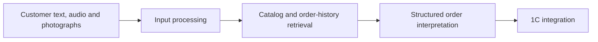

# From customer messages to structured orders

**Food Industry Client · Independent AI Engineer · Aug–Oct 2025**

I independently built an on-premises ordering workflow for a food-industry supplier. It converts customer text, audio and photographs into structured orders connected to the client's 1C system.

The challenge was to preserve the business meaning of an order: the intended catalog item, its packaging and the requested quantity. A plausible language-model answer alone was not the finished product.

## Workflow

## What I implemented

- Built the workflow end to end, including retrieval and the 1C integration.
- Used **BGE embeddings** to retrieve relevant context and a locally deployed **DeepSeek model adapted with LoRA** for order interpretation.
- Iterated on retriever selection, product matching and prompts using client-provided examples.
- Evaluated complete orders, including product selection, packaging and quantity, rather than judging only the wording of a response.

## Deployment and scope

The delivery engagement ran from August to October 2025. By November 2026, the deployed workflow was processing approximately **10,000 orders per day**. This describes the complete workflow's operating volume; it is not a standalone model throughput benchmark or the volume at initial delivery.

## Public material

This page is an implementation summary. Client data, model weights and the original client source code are not included in this repository.

For public examples of adjacent retrieval and integration work, see the team [support-operator assistant](https://github.com/moti4k/The-Illusion-Of-Security) and [business-support Q&A project](https://github.com/moti4k/TINKOFF_LLM_CP2024). These are separate projects, not the supplier system.

[Back to profile](../README.md)
